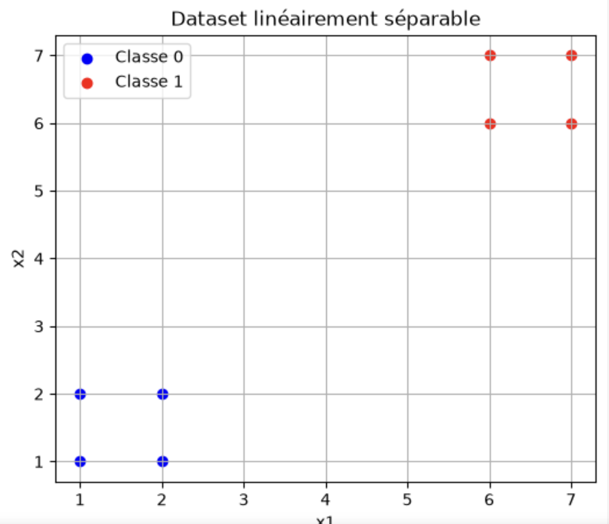
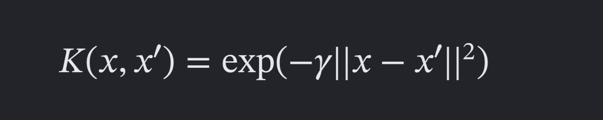
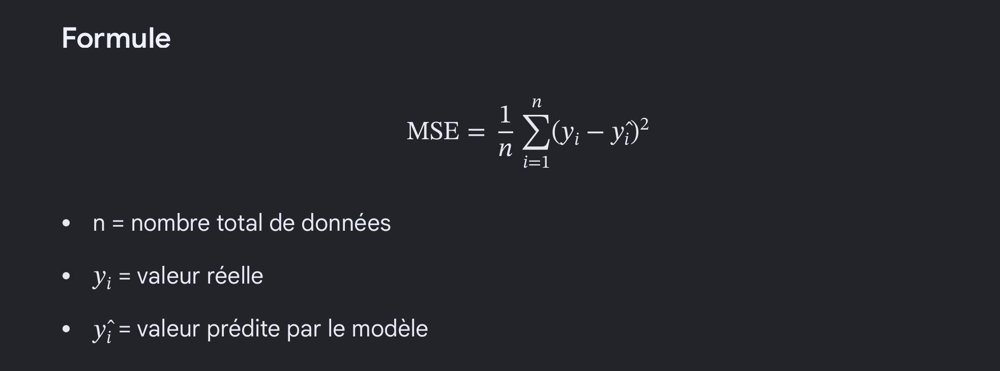
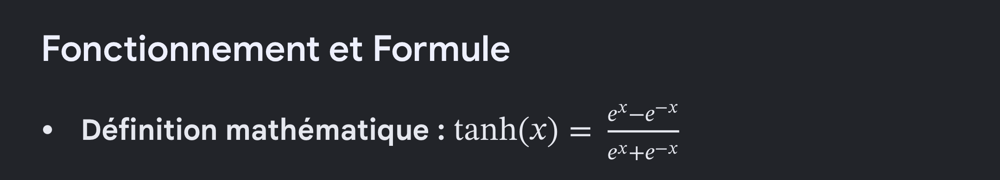

# Projet annuel 

Contexte - Vocabulaire 

* CLASSE = Quand nous parlons de classe, nous désignons une catégorie de déchet que le modèle doit reconnaître.

Exemple: 
- Classe 0 : plastique 
- Classe 1 : verre 
- Classe 2 : métal 


# Etape 1 : Test sur des données linéairement séparables
Le Perceptron simple qui est codé en C n'a aucune couche cachée et ne possède qu'un seul neurone. Le Perceptron classique (inventé par Frank Rosenblatt) est le modèle le plus basique possible : les entrées sont directement reliées à un unique neurone de sortie. Il ne peut séparer que des données parfaitement linéaires.

Comme le perceptron classique n'a besoin que d'un seul neurone, nous utilisons dans notre code en C un tableau de poids qui consiste en un vecteur à une seule dimension ([w1, w2]) - VERSUS 1 couche avec plusieurs neurones = Un tableau à 2 dimensions (une matrice de poids).

Un algorithme beaucoup plus puissant est le Perceptron Multicouche (MLP) entraîné par rétropropagation du gradient.


L'objectif est de tester le modèle sur plusieurs cas simples et connus, avant de les appliquer à la problématique réelle. 
L'objectif est de commencer volontairement avec des problèmes très simples. Nous avons créé volontairement deux problèmes simples. 

On teste d'abord le projet avec des données linéairement séparables. 

X = np.array([
    [1, 1],
    [1, 2],
    [2, 1],
    [2, 2],
    [6, 6],
    [6, 7],
    [7, 6],
    [7, 7]
])

y = np.array([
    0, 0, 0, 0,
    1, 1, 1, 1
])


On observe que les deux groupes de données sont séparés. Il est facilement possible de tracer une droite entre les deux groupes. 


# Etape 2 : Test sur des données non linéairement séparables
Les données non linéairement séparables sont des données qu'on ne peut pas séparer correctement avec une simple droite (2D), ou un plan/hyperplan (dimension supérieure). Un modèle très simple comme un Perceptron classique cherche essentiellement à faire une séparation linéaire. Si les données sont non linéairement séparables, il peut être incapable de trouver une frontière qui sépare correctement les deux classes.


Pour cela, on utilise le problème XOR. 

modele_perceptron = Perceptron(
    max_iter=1000,
    random_state=42
)

- parenthèse sur le RANDOM STATE -
Ci-dessus, on crée un objet Perceptron et on le stocke dans la variable modele_perceptron. En mettant max_iter à 1000, on lui demande de faire 1000 itérations sur les données d'entraînement pour essayer d'apprendre. Le random_state fixé à 42 est un paramètre utilisé pour contrôler le hasard lors de l'entraînement d'un modèle comme le Perceptron. Avant de commencer à apprendre, le Perceptron doit attribuer des valeurs de départ (des poids) à ses connexions. Sans random_state, les poids sont initialisés de manière totalement aléatoire à chaque lancement. Le modèle peut donc converger vers des solutions légèrement différentes à chaque exécution. Avec random_state, le générateur de nombres aléatoires commence toujours au même "endroit". Les poids de départ seront strictement identiques à chaque fois. Le random state permet aussi de comparer les résultats obtenus: si l'on change un paramètre (comme le taux d'apprentissage), le random_state permet de mesurer que l'amélioration vient de ce changement, et non d'un coup de chance de l'initialisation aléatoire.

Graphiquement, voici les résultats :



On observe que le problème XOR n'est pas linéairement séparable. Le perceptron ne peut pas résoudre XOR car il ne peut pas construire une frontière de décision linéaire. 

Cela insiste sur la nécessité d'utiliser un PMC (Perceptron Multi Couches). Les couches de neurones cachées dans le PMC lui permettent d'apprendre des relations non linéaires. 


# Etape 3 : Perceptron Multi-Couches
L’idée est surtout de montrer que le MLP peut apprendre une séparation non linéaire entre les classes de déchets. Le modèle linéaire permet de rechercher une frontière de décision linéaire entre les différentes catégories. Cependant, les caractéristiques visuelles des déchets ne sont pas nécessairement séparables linéairement. Le perceptron multicouche introduit une ou plusieurs couches cachées ainsi que des fonctions d'activation non linéaires, ce qui permet au modèle d'apprendre des relations plus complexes entre les caractéristiques et les classes.

Première étape : Rassembler des photos de déchets 
Pour entraîner le PMC, il faut un dataset d'images étiquetées : chaque photo doit appartenir à une classe.

Deuxième étape: transformer les photos en vecteurs 
Un PMC ne peut pas directement comprendre un fichier .jpg. Il lui faut des nombres. Pour commencer simplement, on peut transformer chaque image en une petite image, par exemple 32 × 32 pixels, puis la transformer en un vecteur.


Rétropropagation
La fonction retropropager est le « professeur » du réseau. Son rôle est de corriger les erreurs. Elle analyse la réponse du réseau pour une image donnée et ajuste légèrement tous les poids (W1, W2) et biais (b1, b2) pour qu'il fasse mieux la prochaine fois.

Étape 1 : Tester l'image et voir ce que le réseau répond
forward(pixel_array, hidden, output, W1, b1, W2, b2, pixel_array_length, hidden_layer_length, output_length);

On commence par exécuter forward. Le réseau analyse l'image (pixel_array) et génère sa prédiction dans le tableau output (ex: 70% Plastique, 10% Verre, 20% Métal).


Mathématiquement, W1 ressemble à une matrice :

        couche_cachee[i] = pixel_array[j] * W1[i * couche_cachee_sizej];

- i indique quel neurone caché on regarde.
- j indique quel pixel/entrée on regarde. 
Pourquoi multiplier i par 12 ? Parce qu'avant d'arriver aux poids du neurone i, il faut sauter toutes les cases des neurones précédents.

# Implémentation en C et lien avec Python
On a écrit les algorithmes (perceptron, PMC) dans une bibliothèque en C, et on les relie ensuite à notre notebook Python pour les tester et comparer les résultats.

Concrètement, chaque algorithme (`ETAPE1.basicPerceptron.c`, `ETAPE2.xor.c`, `ETAPE3.multiLayersPerceptron.c`) est écrit sous forme de fonction, sans `main()` central bloquant l'exécution - par exemple `run_perceptron()` ou `run_pmc()`. Une fonction C classique, une fois compilée normalement, donne un programme exécutable qu'on ne peut lancer que depuis un terminal. Pour que Python puisse s'en servir, on compile ces fichiers différemment, en bibliothèque partagée (`.so`), avec la commande :

```bash
gcc -shared -fPIC ETAPE1.basicPerceptron.c -o ETAPE1.basicPerceptron.so
```

Depuis Python, le module `ctypes` (intégré à Python, rien à installer) permet ensuite de charger ce `.so` et d'appeler directement les fonctions C comme si c'était des fonctions Python :

```python
import ctypes

lib = ctypes.CDLL("C-algorithms/ETAPE1.basicPerceptron.so")
lib.run_perceptron.restype = ctypes.c_int
erreurs = lib.run_perceptron()
```

On a validé ce mécanisme sur les trois premières étapes, testées sur les cas de test :

- Étape 1 (perceptron linéaire) : 0 erreur sur les 8 points de test
- Étape 2 (XOR) : le perceptron simple échoue (2 erreurs sur 4) sur les données brutes, non linéairement séparables ; en ajoutant une caractéristique `x1 * x2` (transformation non linéaire), il converge et n'a plus aucune erreur
- Étape 3 (PMC) : après rétropropagation du gradient sur les 3 exemples de test, le réseau prédit correctement les 3 classes. Le PMC n'a qu'une seule couche cachée (8 neurones) pour rester simple à expliquer.

## Application sur une portion du vrai dataset

Une fois les algorithmes validés sur les cas de test, on les a aussi appliqués à quelques vraies photos de `dataset-img/`. Pour ça, chaque photo est réduite à 2×2 pixels (donc 12 valeurs, la même taille que les cas de test) puis normalisée entre 0 et 1, comme expliqué plus haut pour la transformation des images en vecteurs.

Première approche testée (à éviter) : calculer ces vecteurs en Python puis les recopier en dur dans le fichier `.c`. Ça ne relie pas vraiment C et Python, ça utilise juste Python comme calculatrice avant de figer les données. On a donc changé les fonctions C pour qu'elles reçoivent un pointeur vers les données, envoyées directement par Python à chaque exécution :

```c
int run_perceptron_dataset(double *vecteurs, int *labels, int n_exemples)
```

Côté Python, `ctypes` a besoin de savoir à quoi ressemblent les paramètres (`argtypes`) pour convertir correctement un tableau numpy en pointeur C :

```python
lib_etape1.run_perceptron_dataset.argtypes = [
    ctypes.POINTER(ctypes.c_double),
    ctypes.POINTER(ctypes.c_int),
    ctypes.c_int,
]
erreurs = lib_etape1.run_perceptron_dataset(vecteurs_c, labels_c, len(labels))
```

## Entraînement et test : pourquoi on sépare les photos

Au début, chaque modèle était entraîné et évalué sur exactement les mêmes photos - donc la précision affichée ne disait rien de plus que "le modèle a-t-il appris ces photos par cœur", pas "est-ce qu'il reconnaîtrait une photo jamais vue". On a donc ajouté une vraie séparation entraînement/test (80%/20%, au moins 1 photo de test par catégorie même quand une catégorie est petite) pour le Perceptron (étape 1) et le RBF (étape 5) : on entraîne sur ~80% des photos, puis on mesure la précision sur les ~20% restantes, jamais vues pendant l'entraînement.

Au départ, cette séparation n'était pas possible pour le PMC (étape 3) : `run_pmc_dataset()` entraînait un réseau tout neuf et l'évaluait immédiatement sur le même tableau, en une seule fonction, puis libérait (`free()`) les poids appris avant de retourner - Python ne récupérait jamais le réseau entraîné pour le réutiliser sur d'autres données. On a corrigé ça en modifiant `run_pmc_dataset()` pour qu'elle recopie les poids appris (W1, b1, W2, b2) dans des tableaux fournis par Python avant de les libérer, et en ajoutant une nouvelle fonction `predire_pmc()` qui prédit la classe d'un exemple à partir de poids déjà entraînés, sans ré-entraîner. Ça permet maintenant d'entraîner sur les photos d'entraînement puis de prédire sur les photos de test avec les mêmes poids, comme pour le Perceptron et le RBF.

Résultats actuels (82 photos : 10 plastique, 68 verre, 4 métal - un jeu provisoire, le dataset complet de 1000 photos/catégorie d'Helsy n'est pas encore intégré) :
- Modèle linéaire (étape 1, plastique vs métal) : 55% en entraînement, 67% en test - le modèle linéaire peine sur de vraies photos, cohérent avec sa limite déjà démontrée sur les cas non linéaires (XOR, Cross)
- PMC (étape 3) : 88% en entraînement, 76% en test
- RBF (étape 5) : 88% en entraînement, 94% en test

## Sauvegarde et chargement des modèles

Le SVM (étape 4) avait déjà `svm_sauvegarder()`/`svm_charger()`. On a ajouté la même possibilité pour le Perceptron (`perceptron_sauvegarder`/`perceptron_charger`), le PMC (`pmc_sauvegarder`/`pmc_charger`, en plus des poids maintenant exposés - voir plus haut) et le RBF (`rbf_sauvegarder`/`rbf_charger`). Le principe est le même partout : un fichier texte simple (une ligne d'en-tête avec les tailles, puis les nombres), écrit avec `fprintf`/lu avec `fscanf` - pas de format binaire compliqué. Chaque script `test_etapeN.py` vérifie qu'un modèle rechargé donne exactement les mêmes poids que l'original.

## Client/serveur : prédire sur une nouvelle photo

Le sujet demande une application qui communique avec une API hébergeant les modèles entraînés, capable de prédire sur de nouvelles données. `app/` contient maintenant :

- `app/entrainer_modele.py` : entraîne un SVM un-contre-tous sur `dataset-img/` (noyau RBF) et sauvegarde un fichier par classe dans `app/modeles/` (ignoré par git, comme les `.so` - chacun régénère ses modèles localement avec ce script)
- `app/server.py` : un serveur Flask qui charge ces modèles au démarrage et expose deux routes :
  - `/ping` : vérifie que le serveur tourne
  - `/predict` (POST) : reçoit un vecteur de 12 valeurs (une photo déjà réduite en 2×2 pixels et normalisée) en JSON, et renvoie la classe prédite avec le score de chaque modèle
- `app/client.py` : prend une photo en argument, la transforme en vecteur (`image_vers_vecteur()`, comme partout ailleurs), l'envoie au serveur et affiche la prédiction

Exemple d'utilisation (depuis la racine du repo, dans deux terminaux) :

```bash
python app/entrainer_modele.py          # une seule fois, pour creer app/modeles/
python app/server.py                    # terminal 1 : lance le serveur
python app/client.py dataset-img/verre/01.jpeg   # terminal 2 : demande une prediction
```

Testé sur une photo de chaque catégorie (jamais vue par le modèle au moment du test, mais déjà dans le jeu d'entraînement puisqu'on entraîne sur tout `dataset-img/` ici) : les 3 prédictions sont correctes, avec un score net pour la bonne classe et des scores négatifs pour les deux autres.

# Etape 4 : SVM avec un noyau RBF
Un SVM avec un noyau RBF (Radial Basis Function, ou noyau gaussien) est un modèle de machine learning qui sert à classer des données ou à faire des prédictions lorsque les catégories ne peuvent pas être séparées par une simple ligne droite. 

L'astuce du noyau (kernel trick) : Quand les données forment des motifs complexes (par exemple, des cercles ou des formes entremêlées), le noyau RBF projette ces données mathématiquement dans un espace de dimension très élevée (voire infinie). 

La séparation : Dans cet espace virtuel, les données deviennent linéairement séparables, ce qui permet au SVM de tracer une frontière propre (un hyperplan) pour distinguer les différentes classes. 

Puis, le noyau RBF transforme les distances en score de similarité. Le noyau RBF applique cette formule :



Au lieu de décrire un nouveau point \(X\) par sa position géométrique (par exemple \(x_1=2, x_2=5\)), le noyau RBF va le décrire par sa ressemblance avec A, B et C.Le point X reçoit 3 nouvelles coordonnées (ses scores de similarité RBF) :
Position 1 : Similarité avec A (valeur entre 0 et 1)
Position 2 : Similarité avec B (valeur entre 0 et 1)
Position 3 : Similarité avec C (valeur entre 0 et 1)

Dans cet espace de similarité, les points qui appartiennent à la même catégorie vont naturellement se regrouper.Si \(X\) et \(A\) sont de la même classe (ex: Rouge) et proches géométriquement, leur score de similarité sera très élevé (proche de 1).Si \(B\) est d'une autre classe (ex: Bleu) et éloigné, son score avec \(X\) sera proche de 0.En répétant cela pour tous les points, les points "Rouges" se retrouvent avec des coordonnées élevées sur certains axes, et les "Bleus" sur d'autres axes. Magiquement, dans cette nouvelle dimension supérieure, les groupes se séparent et forment des blocs distincts.

Le tracé de l'hyperplan
C'est ici que le SVM fait son travail classique. Puisque les données sont désormais regroupées de façon logique dans cet espace à N dimensions, il devient possible de faire passer un hyperplan (une coupe parfaitement droite) entre le bloc des Rouges et le bloc des Bleus.

Le noyau RBF ne courbe pas l'hyperplan. L'hyperplan reste strictement droit. C'est le fait de redéfinir la position des points uniquement par leurs scores de proximité qui tord la réalité d'origine et permet à un outil rigide (l'hyperplan) de séparer des formes complexes.

# Etape 5 : RBF Network (Radial Basis Function Networks)
Les Réseaux de Fonctions de Base Radiale, ou Radial Basis Function Networks (RBFN), constituent une classe spécifique de réseaux de neurones artificiels. Leur caractéristique distinctive réside dans l’utilisation de fonctions de base radiale comme fonctions d’activation dans leur couche cachée. Un RBFN est typiquement structuré en trois couches : une couche d’entrée qui reçoit les données brutes, une couche cachée non linéaire basée sur des RBF, et une couche de sortie linéaire qui combine les activations de la couche cachée pour produire le résultat final. Ils sont principalement utilisés pour des tâches d’approximation de fonctions, de classification et de prédiction de séries temporelles.

Contrairement aux réseaux classiques qui utilisent des fonctions d'activation globales (comme les sigmoïdes ou ReLU) influençant tout l'espace d'entrée, chaque neurone de la couche cachée d'un RBF possède un centre et agit comme une « île d'influence ». Le neurone ne s'active que si l'entrée est proche de son centre (souvent via une fonction gaussienne). 

Théoriquement et structurellement, un réseau RBF ne comporte qu'une seule couche cachée, ce qui lui permet d'assurer une approximation universelle sans nécessiter la superposition de multiples couches intermédiaires. 

## Branchement de l'étape 5 : une particularité

Contrairement aux autres étapes, la fonction `RBNF()` du fichier C ne renvoie rien à Python - elle fait seulement des `printf()` côté C. On ne peut donc pas s'en servir comme point d'entrée unique. La solution, sans modifier le fichier C : on appelle depuis Python, dans le même ordre que `RBNF()` le fait en interne, les fonctions individuelles déjà exportées (`find_centroids`, `assign_clusters`, `update_centroids_mean`, `calculer_sigma`, `train_weights`, `calculer_rbf_closeness_to_centroid`, `calculer_output`) - ce qui permet de récupérer les centroïdes, le sigma et les poids appris directement dans des tableaux numpy, et de les réutiliser pour prédire sur de nouvelles données (voir la séparation entraînement/test plus bas).

Pendant les tests, on a trouvé un vrai bug numérique dans le k-means partagé (`assign_clusters`/`update_centroids_mean`) : si un cluster se retrouve vide à une itération, `update_centroids_mean` divise par zéro et son centroïde devient `NaN`. Comme la fonction `calculer_closest_centroid` (dans `utils.c`) compare toujours la distance par rapport au centroïde 0 en premier, dès que ce centroïde-là devient `NaN`, tous les points lui sont assignés pour toujours (une comparaison `distance < NaN` est toujours fausse) - ce qui contamine tout le modèle derrière (sigma, poids, prédictions). On a corrigé ça côté Python uniquement, sans toucher au C : on fait plusieurs tirages aléatoires des centroïdes de départ et on garde celui qui apprend le mieux (une pratique standard pour le k-means, qui est sensible à son initialisation).

Enfin, un des 6 cas de test officiels (Multi Cross, un motif en damier fin) reste une limite connue du RBF tel qu'il est implémenté ici : le sigma (largeur des gaussiennes) est une seule valeur globale, calculée comme la distance moyenne entre tous les centroïdes - trop grossière pour distinguer les bandes fines de ce damier, peu importe le nombre de clusters ou d'epochs (testé jusqu'à k=60, epochs=1500, sans amélioration). Les 5 autres cas de test et le dataset réel, eux, fonctionnent bien.

Mise à jour des centres et clusters: 
K-means fonctionne par répétition de deux étapes :
- assign_clusters : chaque point rejoint le cluster dont le centroïde est le plus proche.
- update_centroids : chaque centroïde se déplace vers la moyenne des points de son cluster.
-> L'affectation des points dépend de la position des centroïdes. Or, après la mise à jour, les centroïdes changent de position. Certains points peuvent donc changer de cluster.

Lors de la mise à jour des centroïdes, on calcule leurs moyennes:
Pour chaque cluster, on calcule la moyenne de tous les points. Cette moyenne devient le nouveau centroïde.
Il faut ensuite recommencer l'affectation à chaque cluster, car, comme les centroïdes ont bougé, il faut vérifier si chaque point appartient toujours au cluster. 

# Difficultés rencontrées
Pour le choix des images, attention à ne pas prendre que des images avec un fond blanc, de peur que le modèle fasse de fausses prédictions. 

En reprenant les étapes 3 (PMC) et 5 (RBF) après la fusion du travail de l'équipe, les résultats étaient soit mauvais soit complètement incohérents, alors que le code compilait sans erreur. Pour le PMC, le forward pass mélangeait la taille de la couche d'entrée et celle de la couche cachée dans l'indexation des poids, et le softmax oubliait l'exponentielle avant de normaliser — deux erreurs de calcul silencieuses, sans crash ni warning, donc faciles à manquer.

Pour le RBF, le programme tournait mais produisait des prédictions aberrantes (des centaines de millions au lieu de nombres entre 0 et 7). En creusant, on s'est rendu compte que `utils.h` et `utils.c` ne parlaient pas la même langue : le header déclarait les fonctions utilitaires en anglais (`compute_output`, `compute_closest_centroid`), alors que le `.c` les définissait en français (`calculer_output`, `calculer_closest_centroid`) — une dérive de convention de nommage en cours de route plutôt que de simples fautes de frappe. Sans prototype correspondant au bon nom, le compilateur supposait par défaut qu'une fonction renvoyant un nombre à virgule flottante renvoyait en réalité un entier, corrompant silencieusement chaque résultat. Une fois les deux fichiers remis en cohérence (tout en français), le RBF s'est mis à converger normalement.

# Définitions de notions (annexes)

# Régression linéaire 
Quand on effectue une régression linéaire en machine learning, on cherche principalement à modéliser la relation linéaire entre une variable cible (ce que l'on veut prédire) et une ou plusieurs variables prédictives (les caractéristiques ou features) afin de faire des prédictions continues.

L'objectif est de trouver la "ligne" mathématique idéale. 

On cherche à déterminer l’équation d'une ligne droite (en 2D), d'un plan (en 3D) ou d'un hyperplan (en dimensions supérieures) qui passe au plus près de l'ensemble des points de données.

Mathématiquement, on cherche à calculer les coefficients optimaux (les poids w et l'ordonnée à l'origine b) de l'équation.

Pour trouver cette ligne idéale, l'algorithme cherche à minimiser une fonction de coût, le plus souvent l'Erreur Quadratique Moyenne (MSE - Mean Squared Error). En clair, on veut que l'écart (le résidu) entre les vraies valeurs de nos données et les valeurs prédites par notre ligne soit le plus petit possible.

Le sens de la relation : Un coefficient positif signifie que si la variable x augmente, la cible y augmente aussi.

# MSE
Le MSE (Mean Squared Error, ou erreur quadratique moyenne) est une mesure mathématique qui calcule la moyenne des carrés des écarts entre les valeurs prédites par un modèle et les valeurs réelles.

Pénalisation : Élever les erreurs au carré donne un poids beaucoup plus important aux grandes erreurs. Un modèle commettant une grosse erreur est donc très fortement pénalisé.




# Tangente hyperbolique (tanh)
Une tangente hyperbolique est une fonction d'activation non linéaire utilisée dans les réseaux de neurones pour transformer des valeurs d'entrée en une plage comprise entre -1 et 1.

La principale différence entre la fonction tanh (tangente hyperbolique) et la fonction sigmoïde réside dans leur plage de valeurs de sortie et leur centrage sur zéro. 

tanh: ses sorties oscillent entre -1 et 1. 



# Fonction sigmoïde 
La principale différence entre la fonction tanh (tangente hyperbolique) et la fonction sigmoïde réside dans leur plage de valeurs de sortie et leur centrage sur zéro. 


